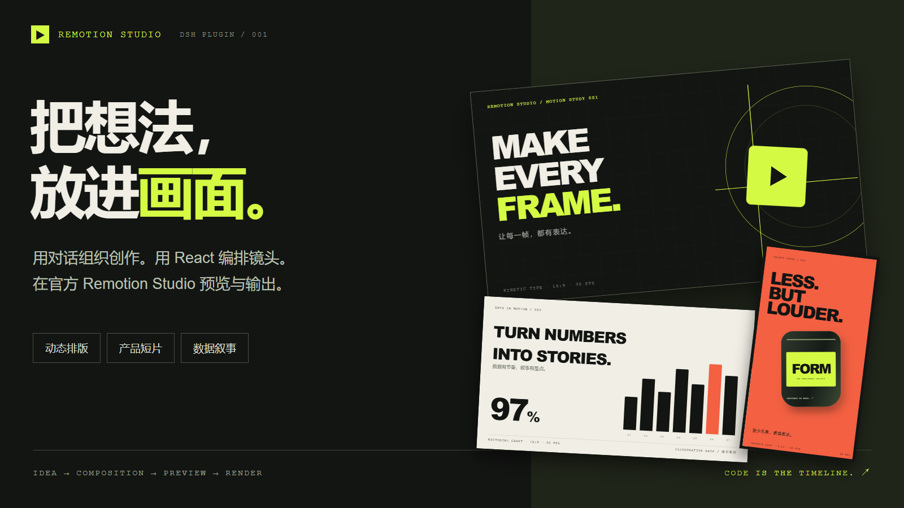
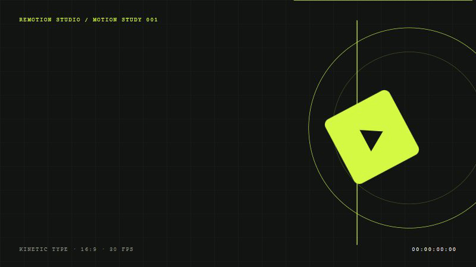
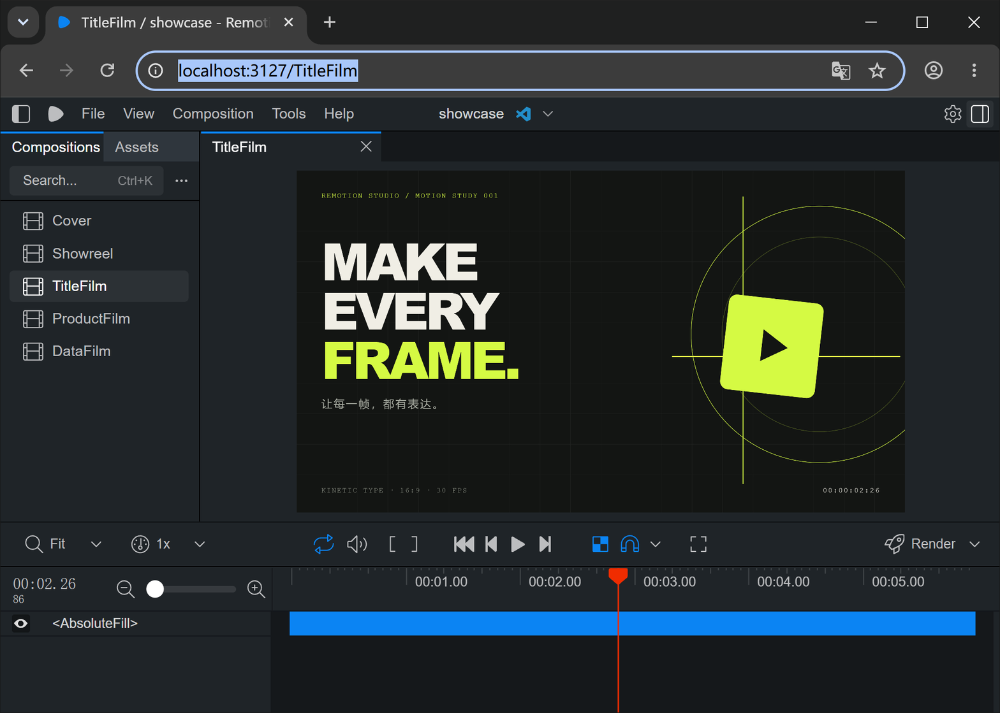

  

# Remotion Studio for DeepSeek Harness

English · [简体中文](README.md)

Create videos with an agent, arrange scenes in React, preview them in the official Remotion Studio, and render through the project's official Remotion CLI.

The showreel covers animated typography, a vertical product film, and animated data graphics. Browse the [showcase source and render instructions](docs/showcase/README.md), or [watch the MP4](docs/media/showreel.mp4).

## Quick start

1. Load this repository with the local plugin workflow supported by your DSH or Seal Harness version. Enable the `remotion-studio` bundle and set the project directory and render environment in the plugin's settings.
2. Ask your agent to check the environment, scaffold a standard React/Remotion project, install its dependencies, and open Studio.
3. Review the composition, timeline, and props in Studio. Ask the agent to render a video or audio file, or export a still frame. The default output directory is `out/`.

The plugin requires Node.js 18 or later, subject to the host's own requirements. Each project installs its own Remotion and React dependencies. The first render may download a browser, or you can configure an installed Chrome.

## What the plugin provides

| Task | Tools and workflow |
| --- | --- |
| Set up a project | `remotion_doctor`, `remotion_project_create`, `remotion_project_install` |
| Preview and refine | `remotion_studio` opens the official Studio for the project's compositions |
| Export the result | `remotion_render` renders video or audio. `remotion_still` exports an individual frame |
| Add narration or images | Configure optional text-to-speech and image providers in the plugin settings |

Text-to-speech and image generation need provider credentials. The sample compositions use React animations and run without model services. The project remains a standard Remotion project that you can edit and run through the official CLI.

  

See the [setup and provider guide](docs/guide.md), the [agent skill](skill/remotion-studio.md), and the [official Remotion documentation](https://www.remotion.dev/docs/).

## License

The plugin code is [MIT licensed](LICENSE). Remotion is a separate project with its [own license](https://www.remotion.dev/license).
