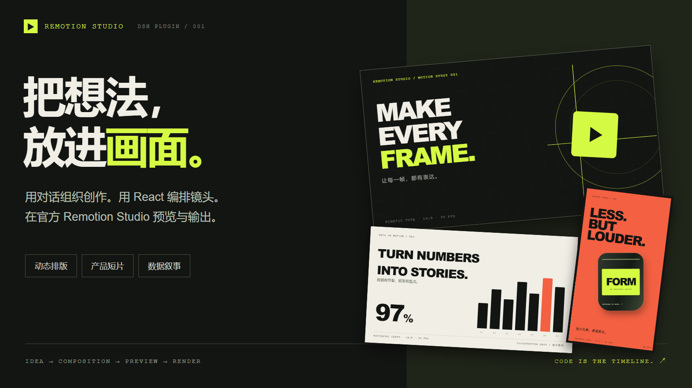
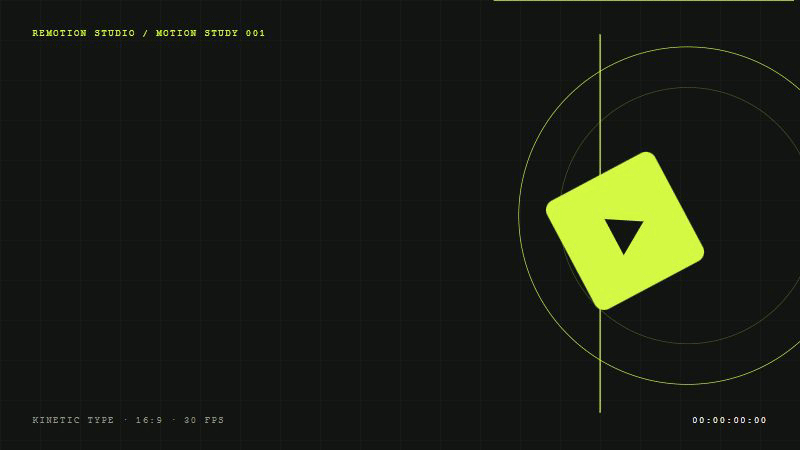
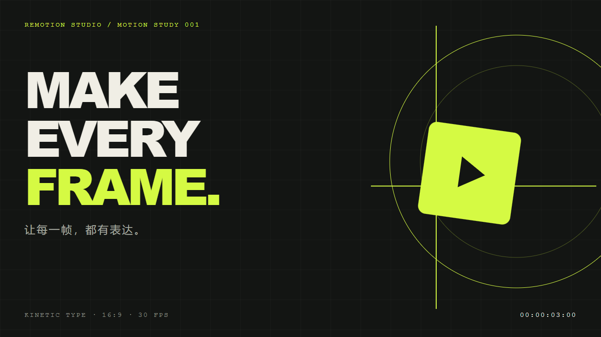
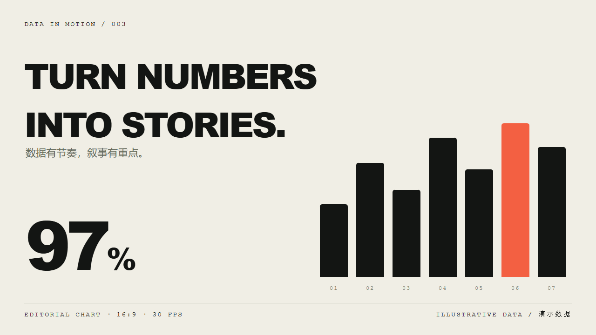
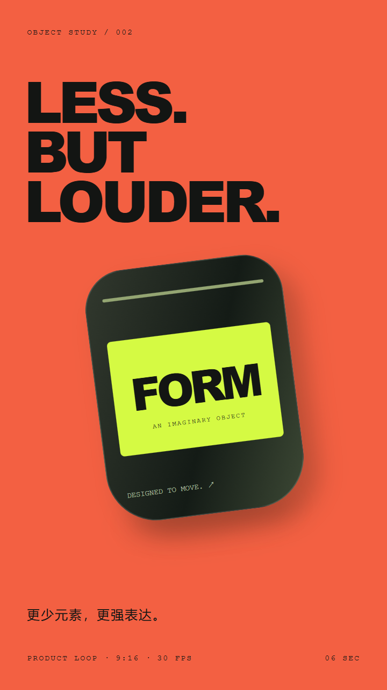
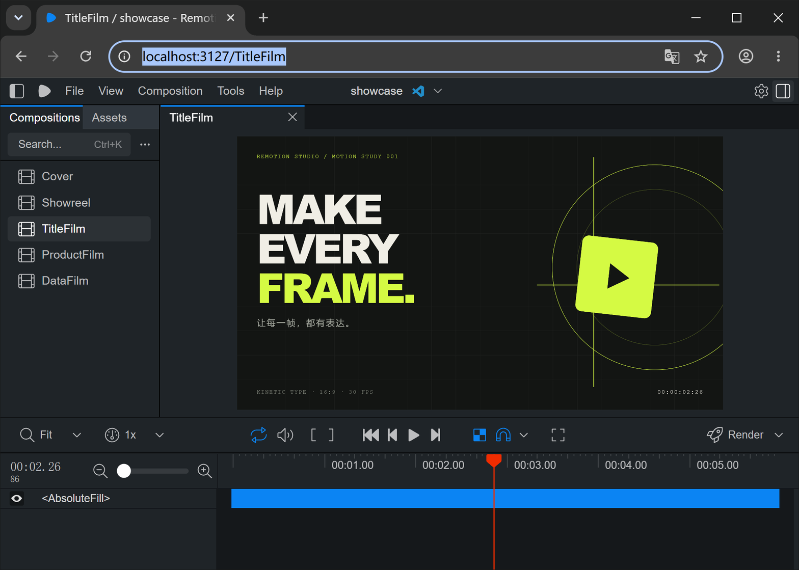

<p align="center"><strong>简体中文</strong> · <a href="README.en.md">English</a></p>

<p align="center">
  
</p>

<p align="center">
  <strong>Remotion 影棚</strong> · DeepSeek Harness 视频创作插件<br>
  对话组织创作，React 编排镜头，官方 Remotion 预览与渲染。
</p>

<p align="center">
  <a href="#先看成片">先看成片</a> ·
  <a href="#三种画面三种表达">作品拆解</a> ·
  <a href="#看得见也改得动">真实工作台</a> ·
  <a href="#从一句话到第一支视频">开始创作</a> ·
  <a href="docs/guide.md">使用与配置</a>
</p>

---

## 先看成片

**12 秒，三个创作方向。** 点击动图查看 MP4；下方每个作品都有独立视频与可复现源码。

[](docs/media/showreel.mp4)

<p align="center">
  <a href="docs/media/showreel.mp4"><strong>▶ 查看 / 下载完整 MP4</strong></a> ·
  1280 × 720 · 30 fps · 12 s · 无声样片
</p>

> **原创样片，真实渲染。** 三支动画均用 React / Remotion 编写，由官方 Remotion 逐帧输出；本次采用纯代码动画，无需模型服务。[源码与复现方式 →](docs/showcase/README.md)

## 三种画面，三种表达

<table>
  <tr>
    <td width="50%" valign="top">
      
      <br><strong>动态排版 / TYPE</strong><br>
      大字入场、几何旋转、时间码。适合片头、观点短片和品牌宣言。<br>
      <sub>16:9 · 1280 × 720 · 6 s</sub><br>
      <a href="docs/media/title-film.mp4">▶ 看成片</a> · <a href="docs/showcase/src/compositions.tsx">看源码</a>
    </td>
    <td width="50%" valign="top">
      
      <br><strong>数据叙事 / DATA</strong><br>
      数字递增、图表生长、重点强调。把静态信息编排成有节奏的画面。<br>
      <sub>16:9 · 1280 × 720 · 6 s · 演示数据</sub><br>
      <a href="docs/media/data-film.mp4">▶ 看成片</a> · <a href="docs/showcase/src/compositions.tsx">看源码</a>
    </td>
  </tr>
</table>

<table>
  <tr>
    <td width="32%" align="center" valign="top">
      
    </td>
    <td valign="middle">
      <strong>竖屏产品短片 / OBJECT</strong><br><br>
      一件虚构产品，一块鲜明底色。用悬浮、旋转和投影，把简单的几何图形变成产品镜头。<br><br>
      <strong>同一套创作方式，换一个画幅。</strong><br>
      Composition 自己决定尺寸、帧率与时长；横屏讲述、竖屏展示，各有节奏。<br><br>
      <sub>9:16 · 720 × 1280 · 6 s · CSS 原创虚构物件，非实拍或生图</sub><br>
      <a href="docs/media/product-film.mp4">▶ 看竖屏成片</a> · <a href="docs/showcase/README.md">本地运行全部样片</a>
    </td>
  </tr>
</table>

## 看得见，也改得动

**创作面板直接使用官方 Remotion Studio。** Composition 列表、画面预览与时间轴来自 Remotion，插件负责启动和复用它。

<p align="center">
  
</p>

<p align="center"><sub>本机实际运行截图 · 官方 Studio · 文档演示工程 · 非插件设置页</sub></p>

| 你想做什么 | 影棚提供什么 |
| --- | --- |
| 从想法开始 | 内置 Skill 给助手提供工作流程；工具可创建标准 Remotion 工程 |
| 边看边调整 | 启动官方 Studio，在浏览器检查画面、时间轴和 Props |
| 给画面加声音、素材 | 可选配音与生图服务，生成的素材保存到项目中 |
| 输出成片或封面 | 渲染视频 / 音频，或导出指定帧静图；支持 CLI 参数透传 |
| 继续手写与维护 | 标准 React / Remotion 工程，预览和渲染调用项目内官方 CLI |

## 从一句话，到第一支视频

### 01 / 准备影棚

通过宿主支持的本地插件加载流程接入本仓库，启用 `remotion-studio` bundle 后，在 **设置 → Remotion 影棚** 配置项目目录和渲染环境。具体加载方式以你的 DSH / Seal Harness 版本为准。

- 宿主运行环境至少 Node.js 18；宿主自身的版本要求优先。文档样片已使用 Node.js 24 实测。
- 每个视频工程需要安装自己的 Remotion / React 依赖；首次渲染需要下载浏览器，或指定本机 Chrome。
- 纯动画可不配置模型服务；需要配音、配图时，再设置相应协议、模型和密钥。

### 02 / 告诉助手你要什么

启用插件后，可以在宿主对话里这样开始：

```text
用 Remotion 影棚制作一支 6 秒的横屏动态标题片。
标题是「让每一帧都有表达」，使用黑底、荧光黄和大字号。
先检查环境，再创建标准工程、安装依赖，最后启动 Studio 让我预览。
这次不需要配音或生图。
```

工具链通常是 `remotion_doctor` → `remotion_project_create` → `remotion_project_install` → `remotion_studio`。助手仍需要编写或调整 Composition；需要安装依赖时，遵循宿主的审批设置。

### 03 / 看画面，再导出

```text
确认预览后，把这个 composition 导出为 H.264 MP4。
再导出第 90 帧，作为视频封面。
```

对应 `remotion_render` 与 `remotion_still`。默认输出到工程的 `out/`；编码、并发、Props 和附加参数均可按需设置。[完整工具速查 →](docs/guide.md#工具由-agent-调用)

## 声音与配图，按需接入

在同一设置页配置 TTS 与生图服务，支持 OpenAI 兼容协议、阿里云百炼 / Token Plan、火山方舟 / Agent Plan，以及火山语音等协议。实际可用的模型、音色和额度由服务商及你的账户决定。

| 配音 | 配图 |
| --- | --- |
| 将旁白文字合成为音频，保存到 `public/tts/` | 按提示词生成图片，保存到 `public/images/` |
| 在 Composition 中用音频素材编排节奏 | 在 Composition 中作为场景、插画或背景使用 |

这些服务需要自行提供访问凭据，可能产生服务商费用。密钥、代理桥接与独立 CLI 的行为边界请先阅读[设置与服务商说明](docs/guide.md#设置面板)。本文样片未验证这些外部服务。

---

## 工程仍然属于你

**插件做接入，Remotion 做预览与渲染。** 不修改、不 fork Remotion；项目仍是标准工程，可以继续使用官方 CLI、编辑 React 代码或升级依赖。离开插件后，纯 Remotion 内容可独立运行；使用服务商桥接的内容需按[文档](docs/guide.md#composition-里怎么用配音配图)准备素材或配置服务。

| 继续了解 | 内容 |
| --- | --- |
| [使用与配置指南](docs/guide.md) | 11 个工具、设置项、服务商协议、凭据与桥接、常见前提 |
| [样片源码与复现](docs/showcase/README.md) | Composition、渲染命令、素材来源与实际验证范围 |
| [给助手的 Skill](skill/remotion-studio.md) | 宿主内的操作流程与工具用法 |
| [Remotion 官方文档](https://www.remotion.dev/docs/) | 动画、Composition、Studio 与渲染能力 |

本插件代码使用 [MIT License](LICENSE)。Remotion 是独立项目，使用时另行遵守其[许可条款](https://www.remotion.dev/license)。本项目与 Remotion 官方无隶属关系。

<p align="center"><sub>REMOTION STUDIO / 把想法，放进画面。 / MADE OF FRAMES.</sub></p>
